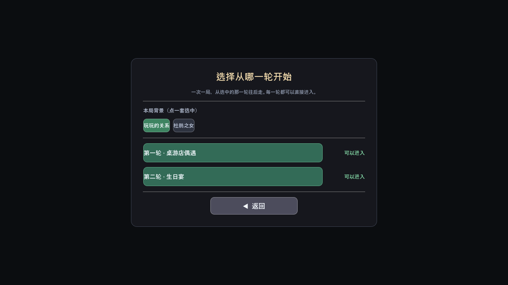
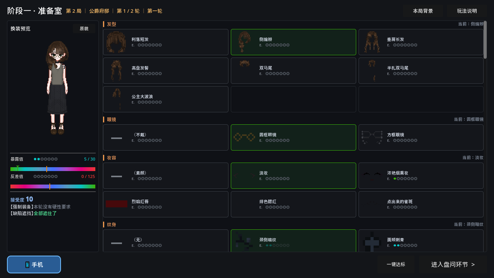
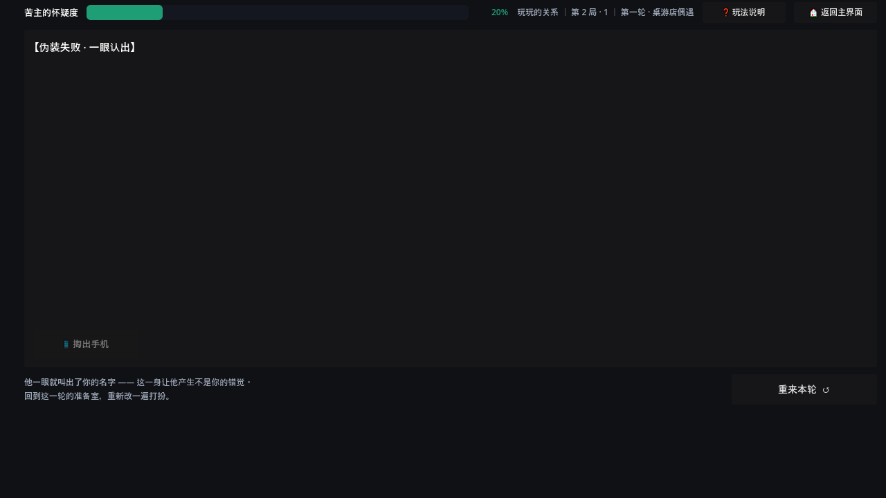
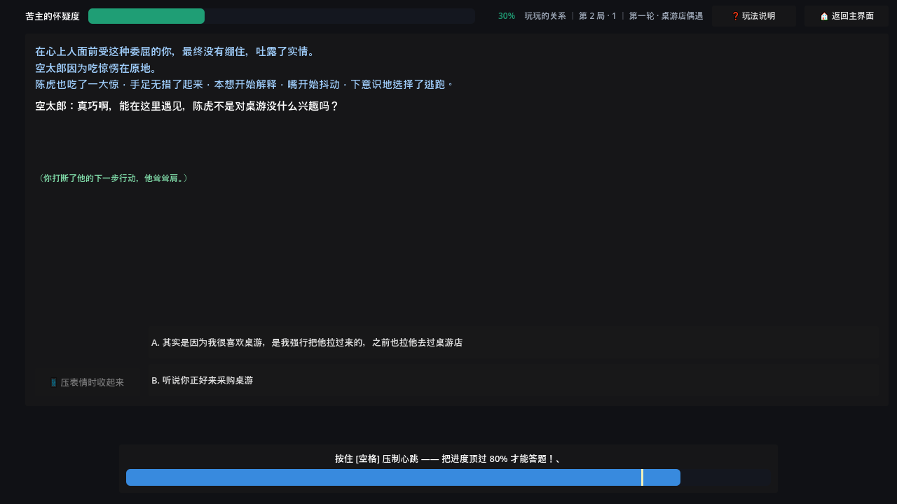
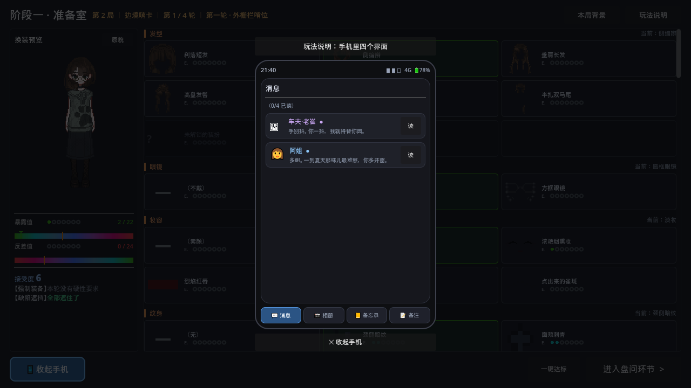
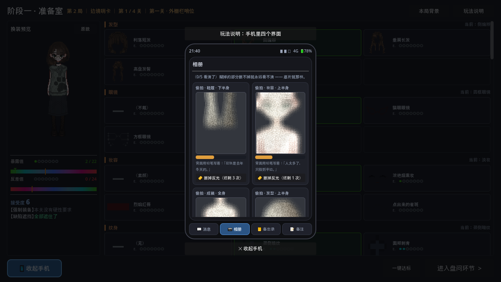

# Faceless: Disguise & Interrogation

A single-player text AVG with dress-up, built in Godot 4.3. One run is two rounds: one dress-up, one interrogation.

> Data formats, the editor, the art pipeline and tests: [`DESIGN.en.md`](DESIGN.en.md).
> 中文版: [`README.md`](README.md)

---

## Quick start

| Goal | Double-click |
|---|---|
| Play | `run_game.bat` |
| Edit story / numbers / copy | `open_story_editor.bat` |

Requires **Godot 4.3**. `run_game.bat` looks for a Godot binary in this order:
the `GODOT` environment variable, a `godot/` folder inside the project, then `godot` on `PATH`.

---

## Premise

The interrogator is **an old acquaintance of "A"**. You are A — a gang courier who now has to pass as "B", someone he has never met.

- He has collected a pile of **dossier fragments** about A. You got copies through an inside contact.
- From those fragments you piece together **how he remembers you** — which secrets he knows, what he thinks you look like — and then dress as the opposite.
- As B you must not say anything only A would know, and must not contradict yourself. He has a good memory and carries a notebook.
- A **companion (C)** travels with you. He knows you are A and that you are pretending to be B, but he neither helps nor exposes you.

| Marker | Who | Notes |
|---|---|---|
| **A** | True identity | You. The person the interrogator knows |
| **B** | Cover | The person you are playing. Must look as unlike A as possible |
| **C** | Companion | Knows the truth, is not on your side |
| **Interrogator** | The one being deceived | Knows A, has never seen B. Temperament is randomised per run |

In the game text the interrogator is called **男主** ("male lead") and the companion **男二**
("second male lead"); in the "Qiuqiu's New Toy" background the companion is a dog, written 男二（狗）.
Those strings live in `data/story.json` and can be edited at will. The A / B / C markers in code never change.

### The two scenarios

The repo ships two scenarios written by the author. Both share the same skeleton — **he knows *you*,
you are playing someone else, and someone who knows the truth is standing right beside you** —
and differ only in who those three people are:

| | Playful Ties (`scene_1`) | Daughter of the Cuckoo (`scene_2`) |
|---|---|---|
| **You** | **Yano**, a private-school student | **Miu** |
| **You play** | Chen Hu's **girlfriend** | **Aiko** — Miu's twin sister |
| **He (male lead)** | **Kotaro**, your boyfriend | **Chikara**, your boyfriend |
| **Beside you (male two)** | **Chen Hu**, a classmate holding leverage over you | **Father**, the man who raised you — and whom you have been seeing behind your boyfriend's back |
| **The two rounds** | board-game shop encounter → Chen Hu's birthday party | fitting-room doorway → a rendezvous spot |
| **Questions** | 6 + 6 | 5 + 6 |

**Playful Ties** — Chen Hu holds footage that makes you look like you schemed to split Kotaro from
his childhood friend, and uses it to force you into posing as his girlfriend. He drags you to a
board-game shop to "run into" Kotaro: you have to be a stranger to **your own boyfriend**, while he
spends the evening talking about "my girlfriend Yano". Round two is his birthday party, and the same
lie has to hold a second time, word for word.

**Daughter of the Cuckoo** — outside a fitting room you walk straight into your boyfriend Chikara.
Startled, you say his name — the disguise collapses on the spot, so you improvise: "I'm Aiko,
Miu's twin sister." Round two, he runs into "Aiko" again and asks deeper: where is your sister,
what was that voice from inside, why does your perfume smell like the one he gave Miu.

**The tension is the same in both**: he is not interrogating you, he is **making conversation**.
But every line of small talk stands on "the person I know" — you have to steer it back without
letting him see you steer.

> Four more factory templates (Border outpost / Town waystation / Ducal residence / Harbour customs)
> live in `scripts/ScenarioData.gd`. The repo's `data/story.json` overrides them; delete the
> background entries in the editor and it falls back to those four.

---

## How a run plays

```
Title screen → Level select (pick a background) → Wardrobe (dress up + check phone)
                                                  ↓
                                          Interrogation (6 questions)
                                                  ↓
                    ┌─────────────────────────────┴─────────────────────────────┐
              Passed (suspicion < 100)                              Failed (recognised / arrested / contradiction)
                    ↓                                                         ↓
              Round 2 (higher acceptance)                          Restart this round (back to wardrobe)
                    ↓
              Run complete → title screen
```

- A run = **one random background + one random true appearance + one random interrogator temperament**, **2 rounds**.
- Each round = one dress-up (wardrobe) + one interrogation.
- Failure only voids **the current round**. True appearance, messages already read, photos already
  cleaned, and acceptance all carry over. Only this round's outfit is redone.
- Acceptance earned each round is banked immediately (`user://profile.json`) and **kept globally**,
  even across retries.

The level select screen can jump straight to either round (the wardrobe check is not recomputed;
only that round's interrogation is played):



---

## Round structure: the wardrobe

The screen has only two things: **dressing up** and **the phone**. Left side is a paper-doll preview
plus two gauges; right side is 12 visible slots, each with a section header and that body part's
garment cards. The phone is a floating panel opened from a button in the bottom-left corner.



Left column, top to bottom: the paper-doll preview (with a small "true appearance" inset for
comparison), the exposure gauge, the contrast gauge, acceptance, and then the **forced equipment**
and **defect cover** checklists — anything missing turns red on the spot.

**This phase does not judge you.** It lays out the numbers and nothing else — no pass/fail.
The verdict happens the moment the door opens in phase two.

### The three numbers

| Stat | Meaning | Rule |
|---|---|---|
| **Exposure** | How revealing a garment is | The sum across all equipped items **must not exceed the cap**; cap = `10 + acceptance × 2` |
| **Acceptance** | How far you are willing to go | Gates high-threshold items (hard requirement); rises each round |
| **Contrast** | How far you deviate from how he remembers you | Summed over all slots; **must be ≥ this round's requirement** or you are recognised on sight |

Shipped values for the two rounds:

| Round | Acceptance | Exposure cap | Contrast required |
|---|---|---|---|
| 1 | 10 | **30** | **125** |
| 2 | 19 | **48** | **150** |

### How contrast is computed

```
per-slot contrast = |your exposure − the true appearance's exposure| × 5
                  + (same exposure but a different garment) ? swap bonus : 0
```

- The **× 5 factor** is `rules.contrast_per_exposure`, editable.
- Swap bonus: **2** base, **12** for hair, **10** for makeup. Both conditions are required —
  the exposure must match **and** it must not be the true-appearance garment.
- **Wearing the true-appearance item scores 0**, whatever its exposure.
- Every **visible** slot counts (i.e. those that pass the underwear visibility gate).

Gauge scales are **absolute**: exposure 71, contrast 270. The threshold marks therefore land in
different places each round, so you can see the budget loosening at a glance.

### The two defects

The character carries two defects that cannot be removed:

| Defect | Tags that cover it |
|---|---|
| **Gang tattoo on the back of the right hand** | `long_sleeve` (2 tops) |
| **Slave brand on the side of the neck** | `high_collar` or `scarf` |

A's true appearance happens to be **one high-collared long-sleeve shirt covering both**.
To raise contrast you must take it off, and the covering duty shifts to the neckwear slot —
**hiding defects** and **not looking like yourself** are inherently opposed.

**If all coverings for a defect sit in a single slot, that slot is excluded from forced-equipment pools**
(`OutfitData.forced_locked_out_slots()`). Otherwise "forced to wear short sleeves" means the tattoo
is exposed *and* the top cannot be changed — an unwinnable round.

### Slots and garments

**19 slot definitions, 7 temporarily disabled, 12 visible to the player. 156 garments, 128 visible.**

| zorder | Slot | Garments | Status |
|---|---|---|---|
| 111 | `makeup` | 6 | visible |
| 121 | `accessory` | 6 | disabled |
| 131 | `piercing` | 4 | disabled |
| 141 | `tattoo` | 7 | visible (multi-slot, up to 2 at once) |
| 161 | `stockings` | 12 | visible |
| 171 | `panties` | 9 | visible |
| 191 | `bottom` | 21 | visible |
| 196 | `tool` | 2 | disabled (manual equip only) |
| 201 | `bra` | 7 | visible |
| 211 | `top` | 26 | visible |
| 216 | `dress` | 12 | visible |
| 221 | `gloves` | 4 | disabled |
| 225 | `shoes` | 8 | visible |
| 231 | `robe` | 4 | disabled |
| 241 | `neckwear` | 10 | visible |
| 251 | `hair` | 7 | visible |
| 261 | `earrings` | 4 | disabled |
| 271 | `glasses` | 3 | visible |
| 281 | `headgear` | 4 | disabled |

Disabling only affects **what the player sees**: the wardrobe omits the section, true appearance
never rolls it, the album never photographs it, forced pools never include it.
**No slot definitions, items, or art were deleted** — remove the id from `OutfitData.DISABLED_SLOTS`
and it comes back exactly as it was.

The `hair` slot has no "none" option (there is always hair), so the base body sprite carries no hair.
The z values in `data/doll_au.json` are what actually determine draw order; the table above is only
for reference.

### Underwear visibility gate

`bra` and `panties` only count toward exposure and contrast **when the underwear is visible**.
Any one of three paths suffices:

| Path | Criterion | Marked on |
|---|---|---|
| 1. Sheer outer layer | Semi-transparent / gauze / lace | The outer garment carries `"see": "sheer"` |
| 2. Cut-out | Slit / ultra-short / cropped, visible through the opening | The outer garment carries `"see": "cutout"` |
| 3. Worn alone | The outer layer for that half is empty, so underwear *is* the outermost layer | The "none" item carries `"bare": true` |

The criterion is "**nothing above it covers it**", not "is there an outer garment" — because the
upper body has two layers:

| Combination | Result |
|---|---|
| High-collar long-sleeve shirt + lace bra | Covered |
| Sheer lace top + lace bra | **Counts** (shows through) |
| (No top) + lace bra | **Counts** (worn alone) |
| High-collar shirt + sheer robe | Covered (the **shirt** covers it) |
| Slip dress + lace bra | Covered (the dress's upper half covers it) |

The check skips disabled slots before looking at the remaining layers. The gate governs
**both exposure and contrast** — invisible underwear carries neither risk nor value.
Covered cards are dimmed in the UI, and hovering says the outer layer covers it.

The auto-solve solver treats "top + bra" and "bottom + panties" **as one group** —
an underwear item's contribution depends on the outer layer, so choosing them separately
would produce an "optimal" solution that does not hold.

### Auto-solve

A debug button in the bottom-right corner satisfies **all** outfit requirements at once:
forced equipment worn, exposure within cap, contrast met. It does not pick an outfit you would
want to wear; it only guarantees the check passes.

---

## Round structure: the interrogation

The interrogator is an old acquaintance of A, probing throughout.

### Recognised on sight

The door opens, he looks up — and sees you, not the person you are playing.

If the wardrobe check failed (contrast too low / defect uncovered / over exposure cap / forced
equipment missing), a layer drops over the screen reading **"Disguise failed · recognised on sight"**,
with one line telling you what gave you away — *"He called your name at once — dressed like this you
no longer look like anyone else."* The result button reads "Restart this round".



The round ends there. Messages you read, photos you cleared and acceptance are all kept —
only the outfit has to be redone.

### Questions per round

Each round has **6 questions**; the question text is one line spoken by the interrogator (or by the
companion). The author sorts questions into rounds with the `level` field:

| | Round 1 | Round 2 |
|---|---|---|
| Playful Ties | 6 | 6 |
| Daughter of the Cuckoo | 5 | 6 |

### How options work

Each question has **2–4 options**, and every option carries its own **suspicion cost** — that cost
is the only thing judgement looks at.

| Cost | Meaning |
|---|---|
| **0** | The right answer for this question |
| 6 / 10 / 20 | Slightly off; survivable |
| 30 / 40 | An obvious slip; two of these and you are in trouble |
| **100** | Recognised on the spot; the round ends immediately |

Each option also carries a `tone` describing what kind of line it is: `correct` (truthful) /
`evade` (deflect) / `bluff` (lie) / `leak` (slip up) / `silence` (say nothing).
**`tone` does not take part in judgement** — one `bluff` can cost 0 while another costs 30,
and that difference is the actual design work.

A few recurring patterns:

| Pattern | Example |
|---|---|
| **Self-exposure trap** | "I'm Yano" — 100. "Ch–Chikara, what are you doing here" — 100 |
| **Two lies, one safer** | "Sister has a fever" — 30 vs "we were up too late last night" — 0, the latter turning the slip into a family shame the sister would also know |
| **Memory test** | Four plausible times; only the one written in the messages costs 0, the rest 40 |
| **Talking over him** | Jumping in to explain halfway through — 30. Answering before you have heard him out costs more than answering wrong |
| **Everyone lies** | Three `bluff` options; what you compare is which lie is hardest to follow up on |

QTE are attached per question: `none` (nothing) / `expression` (the expression bar) /
`auto` (fires on its own timer) / `interference` (the companion cuts in).

### The other mode: the four factory templates

The four factory backgrounds use **auto-assembled questions** (`questions_source` is not `manual`):
no hand-written options; the questions are built on the fly from dossier cards, claims and blind
spots, in a fixed order:

| Position | What | Source |
|---|---|---|
| 1 | A **new claim** question (asks about something new) | Pinned to this round |
| 2 | **Companion question** (attacks the claim you just made) | Pinned to this round |
| 3 | **Blind-spot question** (nothing in the dossier, nothing in the messages) | Pinned to this round |
| 4 | **Cross-round recall** (brings up a claim from an earlier round) | The pool question marked `recall` |
| 5–6 | Dossier questions | 2 drawn at random from the pool |

Round 1 has no previous round, so no recall is scheduled and that slot becomes a third dossier question.

**No contradiction can occur within a round** — each fact is asked at most once per round.
Contradictions only come from cross-round recall.

**Dossier question** — tests "would B know this?". Judged by the card's owner (`card.owner`):

| Card owner | What the "answer directly" option becomes | Effect |
|---|---|---|
| **B card** (the cover dossier you fabricated) | Recite the dossier detail | Suspicion **0** |
| **A card** (only the true identity knows) | Blurt out A's truth | Suspicion **maxed → immediate exposure** |

Always 4 options: A. answer directly / B. improvise / C. deflect / D. silence.

**Claim question** — offers three variants. Any of them is acceptable; **there is no correct answer**.
Whichever you pick becomes your stated position, and you may not change it later.
Matching the official version in the messages costs nothing; contradicting it costs **+70**.

**Blind-spot question** — asks about something absent from the dossier and from the messages.
**There is no correct answer in terms of content.** It has 2–3 options (invent / lie / deflect), and
**the correct choice is whichever of "lie" and "deflect" is cheaper** — which depends entirely on
the interrogator's temperament. The answer is not in the dossier; it is in whether you thought
about *his* temperament.

**Companion question** — he inserts a formal question, offering a **wrong variant** to test you:

| Your response | Effect |
|---|---|
| Push back (restate your claim) | No change |
| Go along with it | Cost of that option |
| Do not engage | No change, not treated as a position |

★ **His question never counts as a contradiction within the round** — he only makes you bleed,
he does not convict you on the spot. Whatever you answer, the line goes into the notebook,
and his wrong variant **never** becomes your stated position.

### Interrogator temperament

Randomised per run. In the **four factory templates** it directly sets how expensive "lie" and
"deflect" are:

| Temperament | Description | Lie | Deflect |
|---|---|---|---|
| **Suspicious** | The smoother you talk, the more he doubles back | **+45** | +12 |
| **Slow** | Average memory, misses the cracks | **+6** | +10 |
| **Shrewd** | He does not threaten — he lets you trip yourself | +30 | +8 |
| **Impatient** | Hates circling; every dodge makes him tap his pen | +10 | **+32** |
| **Soft-hearted** | Years on the job, tired, does not want to press | +18 | **+6** |

In the author's two scenarios the costs are written on the options, so temperament does not enter
the arithmetic — but it still drives two things: the "how to answer him" line in the memo, and
**whether the dangerous option gets a ⚠**.

**This information is registered by opening the memo app.** Once you have opened it, you are
considered to have "noted his temperament", and from then on the dangerous option carries a ⚠ prefix.
If you never opened it, there is no hint at all — the cost still applies, you simply do not know it
in advance.

### Expression QTE

A blue bar appears at the bottom of the screen for a **4-second window**. **Hold space** to push it
past the **80%** line.



```
trigger chance = (exposure − 10) / (60 − 10)     clamped to 0..1
```

| Exposure | Trigger chance |
|---|---|
| ≤ 10 | 0 — never |
| 30 | 0.40 |
| ≥ 60 | 1 — every question |

At current acceptance levels, wearing maximum exposure gives roughly **40% / 76%**.

Four rules:

| Rule | Description |
|---|---|
| **Delayed start** | Appears **3 seconds** after switching to a new question, so you can read it first |
| **Single phase** | Once per question; it ends when the question is answered |
| **Locks phone and options** | The phone is unusable during QTE, and options stay locked until you pass 80% |
| **No reflow** | The bar is an anchored overlay outside any layout, so it never pushes other buttons around |

| Result | Effect |
|---|---|
| Held | No change; brief shake (strength 3) |
| Failed | Suspicion **+48**; shake (strength 10) |

**Question 1 never triggers a QTE** (let the opening line land first).
Questions explicitly marked `qte: expression` still fire. A question with no `qte` is `none` —
which also suppresses the random whispered line.

### Companion interference

He also leans over and murmurs half a sentence to steer the interrogator's attention.
**Interval is a fixed 14 seconds**, independent of exposure.

| Kind | When | How to resist | Window |
|---|---|---|---|
| Single key | Most of the time | Press **space** | 2.6 s |
| Combo | 1 in **3** | Press **J → K → L** in order (a wrong key loses immediately) | 2.6 s |

- Interrupted → suspicion **−3**
- Failed / timed out / wrong combo key → suspicion **+36**

**Questions and interference are separate channels**: questions are formal entries in the sequence
and go through position judgement; interference is a pure QTE that only interrupts.
He uses both within the same round.

### Checking the phone mid-interrogation

A button sits in the bottom-left corner of the interrogation screen, in a fixed position.
Opening it overlays the phone while **the question and options remain clickable**
(the overlay does not consume mouse events). It closes automatically when you answer, and when
the next question loads.

There is a cost — he can see you:

| Pulls | Effect |
|---|---|
| 1st | He assumes you are adjusting your outfit; no penalty |
| **2nd onward** | Suspicion **+16 × pulls over the limit** (2nd +16, 3rd +32, 4th +48 …) |

The phone is locked while holding the expression QTE: the bar appearing closes the phone,
greys out the button and relabels it. It unlocks as soon as you finish.

### Suspicion and resolution

| Rule | Description |
|---|---|
| **Only rises within a round** | All negative deltas are clamped to zero. Answering correctly, staying consistent, interrupting the companion — these only write flavour text |
| **Decays between rounds** | Written to `suspicion_carry` at round end; entering the next round it is **× 0.5**, floored at **10** |
| **Starting value** | Round 1 starts at **20** |

**Resolution:**

| Condition | Result |
|---|---|
| Wardrobe check failed | Recognised on sight; round ends |
| Suspicion reaches **100** | Arrested on the spot |
| **2** contradictions accumulated | Exposed on the spot |
| 6 questions answered with suspicion **< 100** | Round passed; advance |
| Both rounds passed | Run complete; back to title screen |

Failing any round sends you **back to the start of that round** (its wardrobe), not to an earlier one.

---

## The phone

The wardrobe and the interrogation share one phone. Four apps:




| App | Content | Mechanic |
|---|---|---|
| **Messages** | Three threads: the interrogator / companion C / friends | **Only what you read counts**; unlocked per round (one new message each round) |
| **Album** | Photos of A taken by others | Blurry, glare, noise. Repeatedly **wipe the glare** to sharpen; 70% before you can make anything out. Some photos are duds that never become clear |
| **Memo** | This run's notebook, **written by the author per round** | One complete list per round, not cumulative. Supports `{true_name}` `{interrogator}` `{temperament}` `{companion}` placeholders |
| **Notes** | Q&A log accumulated per round | Empty in round 1; from round 2 on, every earlier round's questions and answers are laid out |

**The three message threads each do one job:**

| # | Sender | Contents | What reading does |
|---|---|---|---|
| 1 | The interrogator | Event messages. Normally **empty**, thread hidden | Tells you "he saw that"; reveals no official story |
| 2 | Companion C | Knows you are A, **gives you no story**, only reminds you he is always there | **Teaches 0 facts** — by design, not an oversight |
| 3 | Friends | **The only source of official stories** | Each reveals one "official story of B". Unread ones leave you guessing |

★ Why C's messages deliberately carry no facts: the core of the work is "A is alone in playing B".
If C also supplied facts, there would be a second source of correct answers. An assertion guards this.

**Memo**: each round you can write several paragraphs; in-game they join into one continuous text.
Each round can also tick "append the how-to-answer line" — that line comes from this round's
temperament. The memo may be entirely empty, and **blind-spot feedback does not depend on it**
(feedback reads the temperament table directly).

**Album photo count**: 3 in round 1, 5 by round 2; `scene_1` gets one extra upper-body close-up at
the start. At most **2** (opening batch) / **1** (each later batch) of them are **duds that never
become clear** — even wiping every glare cannot reach the 70% line. Duds are never re-rolled: if you
cannot make it out, you cannot make it out.

Photos are captured live: this run's true-appearance layers are put into a `SubViewport` and shot,
so they always match the current true appearance. Blur, glare, wash-out and grain all come from one
canvas_item shader.

---
